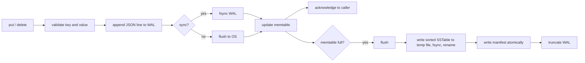
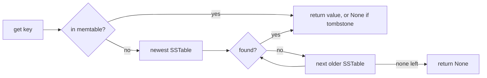

# Custom Database Storage Engine (LSM-Tree)

**Project ID:** PST_AD_172 (Application Development) · **Team:** G507 · Abhishek Kumar, Pudi Khushi · **Mentor:** Aman Kumar

A small, readable **Log-Structured Merge-Tree key-value store in Python 3**. It accepts writes into an in-memory
dictionary (memtable), protects them with a write-ahead log (WAL), flushes the memtable to immutable sorted JSON
files (SSTables) and merges those files with a simple compaction step. A bundled analysis toolkit replays a workload
CSV and uses pandas and matplotlib to show read/write distributions and how query latency changes as the dataset grows.

> A teaching engine, deliberately not RocksDB: clarity of internals matters more than raw speed.

**One-line pitch:** an LSM-Tree that survives a hard process kill without losing acknowledged writes, plus an analysis
toolkit that shows how read/write mix and dataset size affect query latency.

## Quick start

```bash
git clone https://github.com/Aarya918/Custom-database-storage-engine-using-python.git
cd Custom-database-storage-engine-using-python
python3 -m venv .venv && source .venv/bin/activate
pip install -r requirements.txt

python demo.py                                  # 1-minute live demo (includes a real SIGKILL)
python -m unittest discover -s tests -t . -v    # or: pytest
```

```python
from lsm import LSMStore

with LSMStore("./mydb", memtable_limit=1000, sync=True) as db:
    db.put("user:1001", "alice")
    db.put("user:1001", "alice_v2")
    db.delete("user:1002")
    print(db.get("user:1001"))        # alice_v2
    print(db.get("user:1002"))        # None
    print(db.scan("user:", "user;"))  # sorted range read
```

Interactive shell: `python -m lsm.cli ./mydb` (put / get / delete / scan / flush / compact / stats).

## Architecture

Write path (`put` / `delete`):



Read path (`get`): memtable first, then SSTables from newest to oldest. The first match wins; if it is a tombstone
the result is `None`. Each SSTable is skipped quickly by its `min_key`/`max_key` and searched with binary search.



Recovery on `LSMStore(path)`: take the directory lock, delete stray `*.tmp` files and SSTables not listed in the
manifest (leftovers of a crash), validate and load every live SSTable, then replay WAL records whose `seq` is greater
than `manifest.last_flushed_seq`. A torn final WAL line is ignored (and trimmed); corruption anywhere else raises
`CorruptFileError`.

### Source layout

| Path | Purpose |
|---|---|
| `lsm/store.py` | `LSMStore`: memtable, WAL, flush, read path, compaction, recovery, lock |
| `lsm/sstable.py` | SSTable object, JSON validation (structure, sort order, `entry_count`) |
| `lsm/errors.py` | exception classes |
| `lsm/cli.py` | interactive shell |
| `analysis/workload.py` | workload CSV loading and validation |
| `analysis/metrics.py`, `analysis/plots.py` | distributions, percentiles, charts |
| `run_workload.py` | replay a CSV against the engine, record `latency_us` and `dataset_size` |
| `analyze.py` | tables and PNG plots from a results CSV |
| `generate_workload.py` | synthetic read-heavy / write-heavy / mixed workloads |
| `benchmark.py` | write-throughput benchmark with optional LevelDB (`plyvel`) comparison |
| `tests/` | unit, recovery, randomized-vs-dict, SIGKILL and analysis tests |
| `data/`, `results/` | sample workloads and sample outputs |
| `docs/` | metric dictionary, demo script |

## File formats

**WAL** (`wal.log`) — one JSON object per line, append-only:

```json
{"seq":4,"op":"PUT","key":"user:1001","value":"alice_v2"}
{"seq":5,"op":"DELETE","key":"user:1002","value":null}
```

**SSTable** (`sst_000001.json`) — immutable, written to a temp file then renamed. `null` is a tombstone:

```json
{"file_id":1,"min_key":"user:1001","max_key":"user:1002","entry_count":2,
 "entries":[["user:1001","alice_v2"],["user:1002",null]]}
```

**Manifest** (`manifest.json`) — the live set, replaced atomically:

```json
{"live_files":["sst_000001.json"],"next_file_id":2,"last_flushed_seq":5}
```

**Workload CSV** — `seq,op,key,value,timestamp` (`timestamp` optional). The runner adds `latency_us` and `dataset_size`.

## Public API

| Interface | Signature | Purpose |
|---|---|---|
| Open | `LSMStore(path, memtable_limit=1000, sync=True)` | open or create a database directory, run recovery |
| Write | `put(key, value)` | durably store or overwrite a value (returns after the WAL append) |
| Read | `get(key)` | newest value or `None` |
| Delete | `delete(key)` | write a tombstone (deleting a missing key is fine) |
| Scan | `scan(start=None, end=None)` | sorted, de-duplicated pairs with `start <= key < end` |
| Flush | `flush()` | force the memtable into an SSTable |
| Compact | `compact()` | merge all SSTables, keep newest values, drop tombstones |
| Stats | `stats()` | memtable size, number of SSTables, last sequence number |
| Close | `close()` | flush WAL buffers and release the directory lock (also a context manager) |
| Runner | `python run_workload.py workload.csv --db ./data --out results.csv` | replay a CSV and record latency per operation |
| Analysis | `python analyze.py results.csv --out ./plots` | distributions and plots |

Limits: keys are non-empty strings up to 1024 bytes; values are strings up to 1 MiB.

Errors: `InvalidKeyError`, `InvalidValueError`, `CorruptFileError` (names the file), `DatabaseLockedError`,
`StorageIOError`, `StoreClosedError`, `WorkloadFormatError`.

## Durability rules implemented

1. **Write path:** WAL append (+`fsync` when `sync=True`) happens before the memtable update and before the call returns.
2. **Flush:** sorted temp file, `fsync`, atomic rename, manifest update, and only then WAL truncation. Tombstones are written to the SSTable.
3. **Read path:** memtable, then SSTables newest to oldest; a tombstone as first match means `None`.
4. **Compaction:** merge all files, newest wins, drop tombstones (safe because *every* file is merged); write temp file, rename, update manifest, then delete old files.
5. **Recovery:** replay WAL records newer than `last_flushed_seq`; ignore a torn last line; report other corruption.
6. **Safety:** files are never modified in place, a lock file (`flock`) rejects a second process, every JSON file is validated on load.

Crash points covered: killed mid-write (WAL replay), killed during flush (orphan SSTable/temp file removed, WAL still has the data),
killed after the manifest but before WAL truncation (already-flushed seqs are skipped, no duplicates), killed during
compaction (old files stay valid, new orphan removed, or leftover old files removed).

## Tests and evidence

```bash
python -m unittest discover -s tests -t . -v        # all tests (about 10 s)
CRASH_ITERS=300 python -m unittest tests.test_crash # many SIGKILL iterations (seed via CRASH_SEED)
```

| Evidence | Where |
|---|---|
| Crash-recovery test: writer subprocess killed with SIGKILL mid-write, reopened, every acknowledged write verified (repeated) | `tests/test_crash.py`, `tests/crash_writer.py` |
| Randomized test against a plain Python dict (12 seeds, 1500 operations each, includes flush, compact and reopen) | `tests/test_random.py` |
| WAL, flush and compaction crash-point tests, corruption tests | `tests/test_recovery.py`, `tests/test_engine.py` |
| Workload validation, distributions, percentiles, edge cases | `tests/test_analysis.py` |
| Metric dictionary with formulas | `docs/metric_dictionary.md` |

Latest run on the development machine: 43 tests pass; the SIGKILL test ran 300 kills with 51,817 acknowledged
operations and recovered 100% of them. Re-run it yourself, since the kill points are random.

## Analysis and results

```bash
python generate_workload.py --shape mixed --ops 10000 --seed 7 --out data/workload_mixed.csv
python run_workload.py data/workload_mixed.csv --db ./tmpdb --fresh --memtable-limit 200 --no-sync --out results/results_mixed.csv
python analyze.py results/results_mixed.csv --out results/mixed --window 10min
```

Replaying `data/sample_workload.csv` (the six-row example from the PRD) gives `get(user:1001) = alice_v2` and
`get(user:1002) = None`; its distribution is 2 GET / 3 PUT / 1 DELETE (33.3% reads, 66.7% writes).

| Workload (10,000 ops, `memtable_limit=200`) | Reads / writes | SSTables at the end | p50 / p95 read latency at the smallest dataset | at the largest dataset |
|---|---|---|---|---|
| mixed | 50.7% / 49.3% | 23 | 0.41 / 1.42 µs | 4.10 / 10.66 µs |
| mixed + `compact()` every 1000 ops | same | 1 | 0.42 / 1.15 µs | 1.66 / 2.87 µs |
| read-heavy | 90.1% / 9.9% | 4 | 0.26 / 0.40 µs | 0.79 / 1.32 µs |
| write-heavy | 10.0% / 90.0% | 43 | 0.78 / 2.58 µs | 7.08 / 16.42 µs |

Reading the plots: read latency climbs as SSTables accumulate because `get()` may have to check more files; compaction
brings it back down. The write-heavy workload accumulates the most files and shows the largest slowdown.


Generated files live in `results/` (distribution JSON, per-window CSV, latency-by-bucket CSV, PNGs). The numbers above were
measured in a single-CPU development sandbox and will differ on your machine; they are timings of cached in-memory
lookups, so look at the shape of the curves rather than the absolute values.

## Benchmark method and report

`python benchmark.py --writes 5000 --value-size 100` writes sequential unique keys and reports writes per second for
`sync=True` and `sync=False`. If `plyvel` is installed it runs the same workload against LevelDB on the same machine and prints
the ratio. The PRD target is the engine being within 10x of LevelDB.

Sample report (`results/benchmark_report.md`, single-CPU sandbox, Python 3.12, 3,000 PUTs, 100-byte values, `memtable_limit=1000`):
**about 6,900 writes/s with `sync=True` and about 89,500 writes/s with `sync=False`.**
**The LevelDB baseline has not been measured yet**: install `plyvel` and re-run `benchmark.py` on your machine to complete
the comparison, and do not quote the 10x target as met until that table is filled in.

## Known limitations

- Pure Python and JSON: throughput is far below a native engine, and `sync=True` is limited by disk fsync speed.
- `sync=False` flushes to the OS but does not fsync each write, so a *power failure* (not a process kill) can lose the last writes. A process kill (SIGKILL) is still safe in both modes.
- Single process, single thread; the directory lock is enforced with `flock` on Linux/macOS (a best-effort `msvcrt` lock on Windows, which is otherwise untested; the SIGKILL test is skipped there).
- SSTables are loaded fully into memory at open; there is no bloom filter or sparse index, and compaction merges everything into one file (no leveled or size-tiered strategy).
- Latency is measured per call without a separate warm-up phase; at microsecond scale the measurements are noisy, which is why p50 and p95 over many samples are reported.
- Keys and values are strings only.

## Future improvements

Bloom filter per SSTable, leveled or size-tiered compaction compared side by side, checksums on WAL records and SSTables,
write/read amplification metrics, batched WAL sync mode, and a LevelDB comparison across several value sizes.
